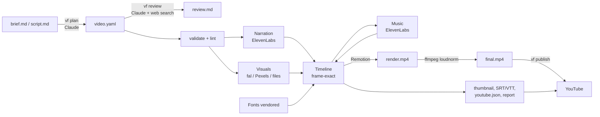

# Architecture



## Principles

**One source of truth.** `video.yaml` describes the whole video. Everything else is derived and lives in `build/`, which is disposable.

**Human checkpoints where judgment matters.** The planner writes a draft spec; a person reads it. The fact-checker writes a report; a person decides. Publishing defaults to private. Automation does the tedious part, not the editorial part.

**Pay once per asset.** Every generated asset is cached by a hash of everything that affects it (provider, model, text or prompt, voice settings, aspect). Change one scene and only that scene re-bills. The cache lives in `.vf-cache/` (or `VF_CACHE_DIR`) and is shared across projects.

**Deterministic renders.** The renderer reads only `build/timeline.json` and files in `build/public/`. Fonts are downloaded into the build. Nothing hits the network during a render, so the same timeline always renders the same video.

## Stages

| Stage | Code | Notes |
|---|---|---|
| Spec | `src/spec/schema.ts`, `load.ts` | zod schema with defaults; cross-checks cues, files, prompts |
| Lint | `src/pipeline/lint.ts` | Editorial heuristics; never blocks a build |
| Narration | `src/pipeline/assets.ts` `buildVoice`, `src/providers/tts/*` | One TTS call per scene. `[[cues]]` and pronunciations handled in `src/text/narration.ts` |
| Visuals | `buildVisuals`, `src/providers/fal.ts`, `image/*` | ai-image, ai-video (still then image-to-video), stock, files. Concurrency 3 |
| Fonts | `src/pipeline/fonts.ts` | Google Fonts woff2 files for the theme, latin + latin-ext |
| Timeline | `src/pipeline/timeline.ts` | Pure function. Scene lengths from audio, transition overlaps, cue frames, caption words, chapters, music ducking windows |
| Music | `buildMusic` | Generated to length after the timeline is known |
| Render | `src/pipeline/render.ts`, `src/remotion/*` | Remotion bundle + `renderMedia`. Scale preset for 540p to 4K from one 1080p design |
| Master | `src/pipeline/post.ts` | Two-pass loudnorm to -14 LUFS / -1 dBTP, `+faststart` |
| Package | `post.ts` | Thumbnail still, SRT/VTT, YouTube metadata with validated chapters, report |
| Publish | `src/publish/youtube.ts` | Resumable upload, thumbnail, caption track, playlist |

## How sync works

1. Narration text is parsed into words, cue markers and audio tags. Pronunciation swaps produce the TTS text while a char-range map remembers which display word each TTS span belongs to.
2. ElevenLabs returns the start and end time of every character. Those are mapped back to display words, and each cue takes the start time of the word after it. Providers without timestamps get an estimate weighted by punctuation pauses.
3. The timeline converts everything to frames relative to each scene's start, adding the lead-in. Scene templates read `scene.cues[name]` and start their entrance spring on that frame.
4. Captions use the same word timings, offset to absolute frames, so the highlighted word and the reveals always agree.

## Scene timing

```
scene i:   |leadIn| narration ............ |tail| transition-out |
scene i+1:                                        | transition-in |leadIn| narration ...
```

Each scene's own length is `leadIn + narration + tail` (or its `duration` if longer). It is padded by the next scene's transition so the overlap never covers narration. Music ducks during every narration window with a 0.25 s attack and 0.6 s release.

## Layout system

Templates are designed once on a 1080-pixel short edge. `useLayout().u(px)` scales that to the composition, and `portrait` switches row layouts to columns, so 16:9, 9:16 and 1:1 all work from one template. Bottom padding keeps content clear of captions and, in vertical video, of the Shorts UI.

## Extending

| To add | Do |
|---|---|
| A scene template | See the end of [SPEC.md](SPEC.md) |
| A theme | Add an entry to `THEMES` in `src/spec/themes.ts` (the tests check text contrast) |
| A font | Import it in `src/remotion/fonts.ts` and add it to `FONT_LIBRARY` |
| An image or video model on fal | Add a preset in `FAL_IMAGE_MODELS` / `FAL_VIDEO_MODELS` mapping our request to its inputs, or just set its id (generic inputs are tried) |
| A new provider | Implement `TTSProvider`, `ImageProvider` or `VideoProvider` (`src/providers/types.ts`) and wire it in `src/providers/index.ts` |
| A render preset | `RENDER_PRESETS` in `src/pipeline/project.ts` |

## Licensing notes

Remotion is free for individuals and companies with up to 3 employees; larger companies need a company license (set `REMOTION_LICENSE_KEY`). Check each provider's terms for commercial use of generated media; the manifest records which provider and model made every asset.
